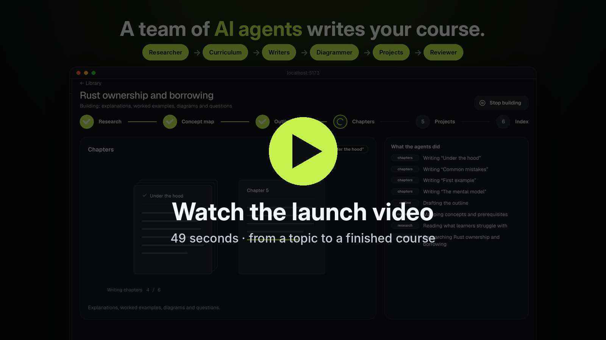
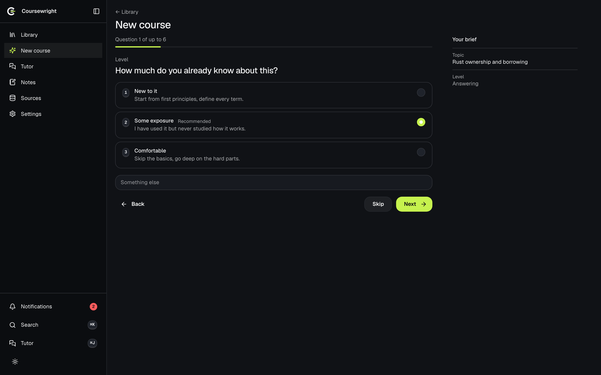
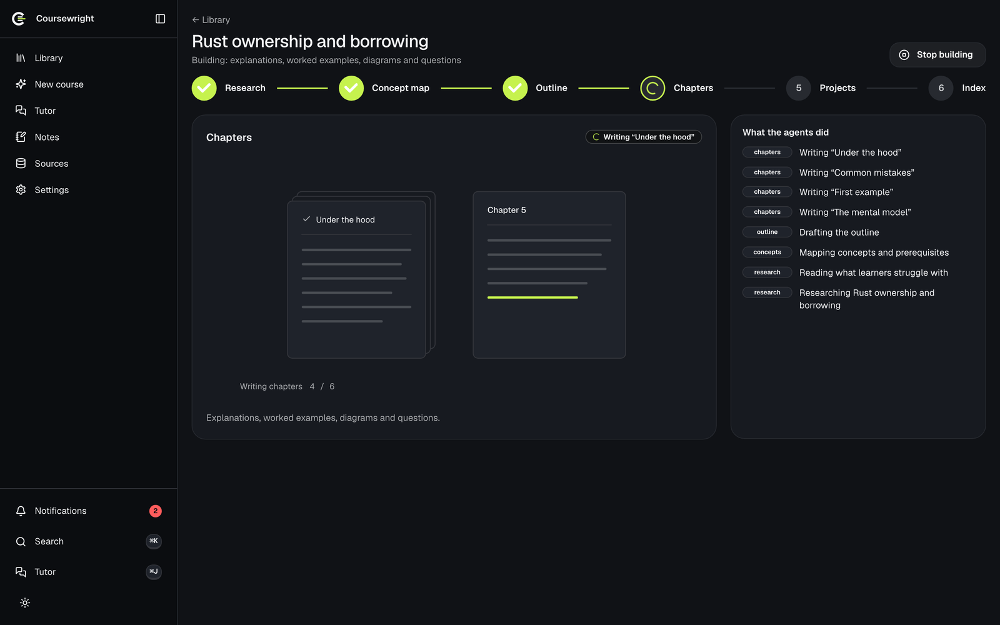
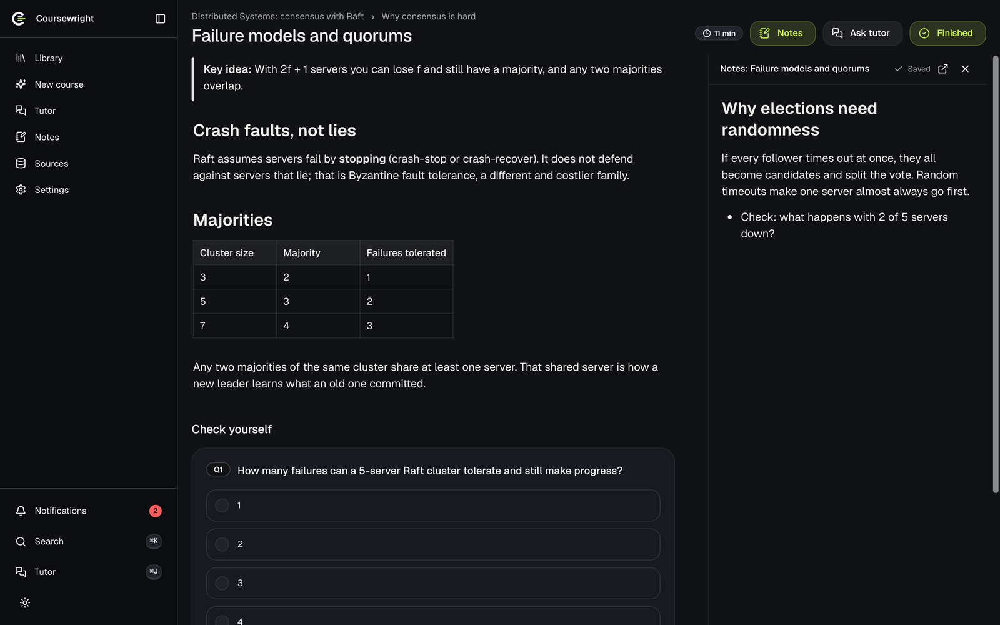
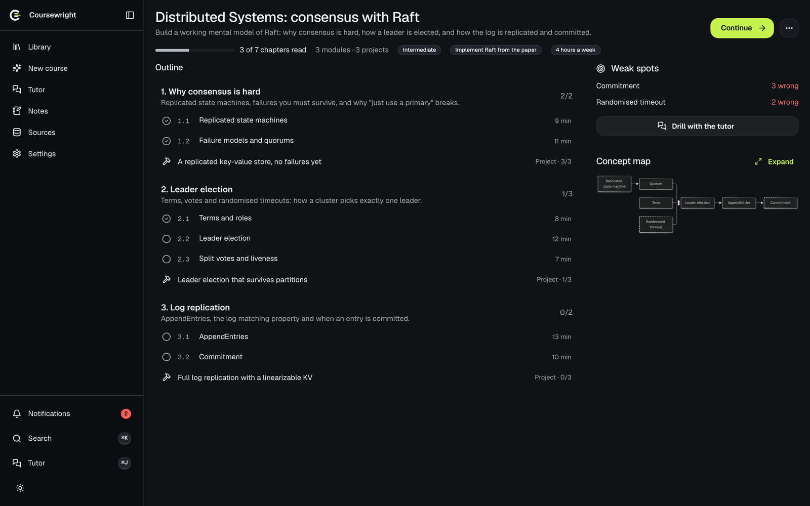
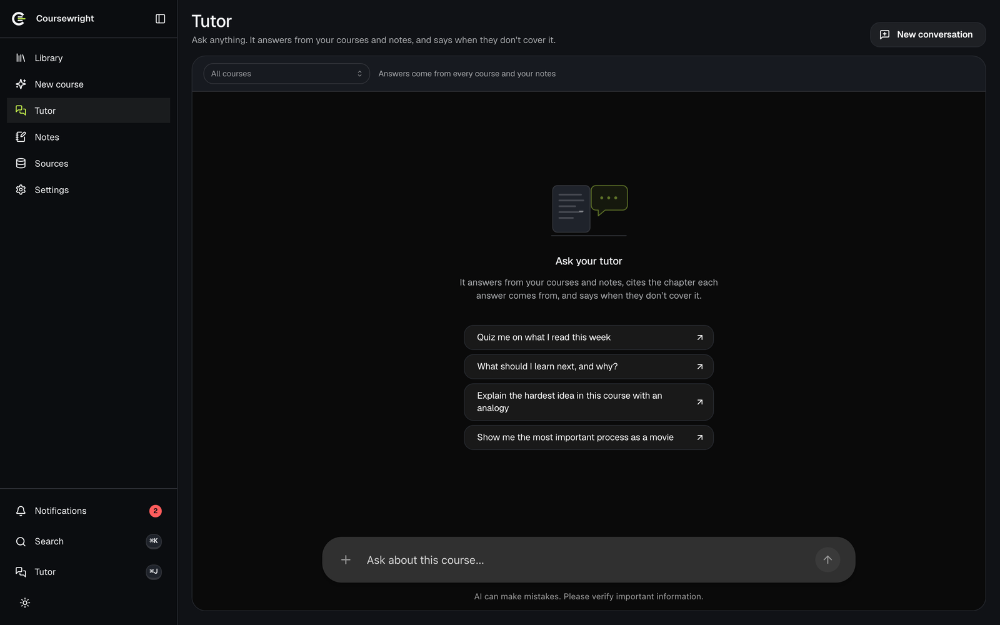
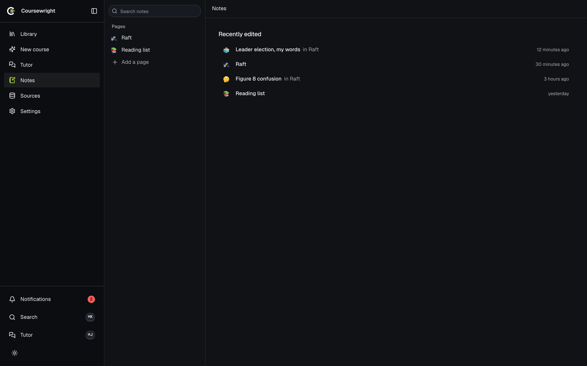

<p align="center">
  <picture>
    <source media="(prefers-color-scheme: dark)" srcset="public/brand/lockup-dark.svg">
    
  </picture>
</p>

<p align="center">
  <strong>Name anything you want to learn. A team of AI agents writes you a course.</strong><br>
  Chapters explained from first principles, step-by-step diagrams, quizzes, projects,
  a tutor that answers from your own course, and notes beside every chapter.
</p>

<p align="center">
  <a href="#run-it-in-a-minute">Run it</a> ·
  <a href="#what-you-get">Features</a> ·
  <a href="#how-it-works">How it works</a> ·
  <a href="#set-it-up-with-your-own-ai-key">Set up</a> ·
  <a href="LICENSE">MIT licence</a>
</p>

<p align="center">
  
</p>

<p align="center">
  <a href="docs/media/launch.mp4"></a><br>
  <sub><a href="docs/media/launch.mp4">Watch the launch video</a> (49 seconds)</sub>
</p>

## Run it in a minute

You need Node 20 or newer. No API key, no backend: the app runs on realistic mock data, including a finished
course on Raft consensus.

```bash
git clone https://github.com/shivarajbakale/coursewright.git
cd coursewright
npm install
npm run dev            # http://localhost:5173
```

To build your own courses and talk to the tutor, [set it up with your own AI key](#set-it-up-with-your-own-ai-key).

## What you get

<table>
  <tr>
    <td width="50%"><br>
      <strong>A short interview, not a form.</strong> Name a topic and answer a few questions one at a time:
      how much you know, what you want to be able to do, how much time you have. Number keys pick, Enter moves on.</td>
    <td width="50%"><br>
      <strong>Watch it being built.</strong> Agents research the topic, map the concepts, outline modules, write
      chapters, draw diagrams and design projects. Each stage animates live; leave and come back any time.</td>
  </tr>
  <tr>
    <td><br>
      <strong>Read, and write beside it.</strong> Chapters start from the problem, define every term and build one
      idea at a time. Open notes next to the text; select a passage to quote it in.</td>
    <td><br>
      <strong>See where you are.</strong> Modules, chapters and a project per module, your progress, the concepts
      you keep missing, and a map of how the ideas depend on each other.</td>
  </tr>
  <tr>
    <td><br>
      <strong>A tutor that knows your course.</strong> It answers from your chapters and notes with citations,
      says when your course doesn't cover something, quizzes you, and turns a process into a step-by-step movie.
      It also opens beside any screen with ⌘J.</td>
    <td><br>
      <strong>Notes that stay connected.</strong> Nested pages, a block editor, @-mentions of chapters, diagram
      and quiz blocks, and backlinks. Every chapter's notes live under its course.</td>
  </tr>
</table>

And the rest you'd want: projects with milestones, hints and a GitHub code review; a search index you can inspect
and test on the Sources page; notifications when a build or review finishes; Continue for a build that stopped;
resizable panels; light and dark themes; and empty and error states that tell you what to do next.

## How it works

```
 Interview ──▶ brief ──▶ ┌──────────── course builder (deepagents) ────────────┐
                         │ researcher → curriculum → writers → diagrammer      │
                         │            → project designer → reviewer            │
                         └──────────────────────────┬──────────────────────────┘
                                                    ▼
                    chapters · questions · diagrams · projects  (files → SQLite)
                                                    ▼
                    hybrid search index (sqlite-vec + FTS5)  ◀── your notes, links you add
                                                    ▼
                    tutor (CopilotKit + deepagents): answers with [n] citations
```

- **One shared rule for clarity.** Every agent that writes for the learner follows the same
  [explaining rules](agent/app/prompts/course_format.md): start from the problem, define each term before using
  it, intuition before formula, no "simply" or "obviously". The reviewer treats unclear writing as blocking.
- **Builds that survive.** Builds checkpoint as they go. A stopped or interrupted build continues from where it
  was, and a build that has written its whole course is saved even past its token budget.
- **Diagrams that are checked.** Movies are [Flowmovie](agent/vendor/flowmovie) scripts, compiled
  and checked before they ship; anything that fails falls back to Mermaid.

More: [architecture](docs/plan/architecture.md) · [API contract](docs/plan/api-contract.md) ·
[agent service](agent/README.md).

## Set it up with your own AI key

`npm run dev` above runs the web app alone on demo data. To build your own courses and talk to the tutor,
run the full app: the web app, the tutor runtime and the Python agent service, with a model key. It takes
about five minutes.

### 1. What you need

| | Check | Get it |
| --- | --- | --- |
| Node.js 20 or newer | `node -v` | [nodejs.org](https://nodejs.org) |
| uv (Python tooling; installs Python 3.12 for you) | `uv --version` | `curl -LsSf https://astral.sh/uv/install.sh \| sh` or `brew install uv` |
| A model API key | | Claude: [console.anthropic.com](https://console.anthropic.com) → **API keys** → **Create key** (starts with `sk-ant-`). Or any Anthropic-compatible provider, [see below](#use-another-model). |

### 2. Install

```bash
git clone https://github.com/shivarajbakale/coursewright.git
cd coursewright
npm install
cd agent && uv sync && cd ..
```

### 3. Add your key

```bash
cp agent/.env.example agent/.env
```

Open `agent/.env` and put your key after the `=`, with no quotes or spaces:

```bash
ANTHROPIC_API_KEY=sk-ant-your-key-here
```

`agent/.env` is ignored by git, so the key stays on your machine. These are all the keys the app reads:

| Key | Needed? | What it does |
| --- | --- | --- |
| `ANTHROPIC_API_KEY` | **Yes**, to build courses and use the tutor | The model that runs every agent |
| `ANTHROPIC_BASE_URL`, `CW_MODEL` | No | Use another provider or model ([below](#use-another-model)) |
| `VOYAGE_API_KEY` | No | Better search over your courses and notes ([voyageai.com](https://www.voyageai.com)); without it a local embedder is used |
| `GITHUB_TOKEN` | No | Higher GitHub rate limits when reviewing project code |
| `CW_BUILD_TOKEN_BUDGET` | No | Tokens after which a build stops polishing and saves the course (default 4,000,000) |

### 4. Start it

```bash
npm run dev:stack
```

Open **http://localhost:5173**. The command starts all three processes (agent on 8123, tutor runtime on 4000,
web on 5173) and **Ctrl-C** stops them all. The first start creates the database in `agent/data/`, adds a
sample course on Raft consensus and indexes it, which takes a few seconds.

### 5. Check that the key works

- `curl http://localhost:8123/api/health` shows `"anthropic": true`.
- The Library has no "No model connected" banner.
- **New course** asks questions about *your* topic. Without a working key it falls back to four fixed questions.

### Use another model

Any provider with an Anthropic-compatible API works. For MiniMax, put these three lines in `agent/.env`:

```bash
ANTHROPIC_API_KEY=your-minimax-key
ANTHROPIC_BASE_URL=https://api.minimax.io/anthropic
CW_MODEL=MiniMax-M3
```

`CW_MODEL` also picks a Claude model, e.g. `CW_MODEL=claude-sonnet-5-5`; the default is `claude-opus-5-5`.

**About cost:** building a course runs a team of agents and makes many model calls, typically several
million tokens per course. Check your provider's pricing first; a smaller model (Sonnet, or MiniMax) costs far
less. Reading, notes, quizzes and search use no model calls.

### If something doesn't work

| What you see | What to do |
| --- | --- |
| The "No model connected" banner stays | The key wasn't read. Check the file is `agent/.env` (not `.env` at the root), the line is exactly `ANTHROPIC_API_KEY=...`, then stop and restart `npm run dev:stack`: keys are read at start. |
| `uv: command not found` | Install uv (step 1), then open a new terminal. |
| "address already in use" | Something else is using port 5173, 4000 or 8123. Stop it, or move a process with `RUNTIME_PORT`, `AGENT_URL`, `VITE_API_URL` and `VITE_RUNTIME_URL`. |
| The tutor says "Runtime info request failed with status 502" | The tutor runtime isn't running. Start everything with `npm run dev:stack`, not `npm run dev`. |
| A build stopped | Open it from the Library and press **Continue**: it picks up where it stopped. |
| You want a clean slate | Stop the app and delete `agent/data/`. The sample course comes back on the next start. |

Every setting is listed in [agent/README.md](agent/README.md#environment).

| Process | Port | Built with |
| --- | --- | --- |
| Web app | 5173 | React 19, TypeScript, Vite, Mantine 9, TanStack Router and Query |
| Tutor runtime | 4000 | CopilotKit runtime (Node) |
| Agent service | 8123 | Python 3.12, FastAPI, deepagents / LangGraph, SQLite with sqlite-vec and FTS5 |

## Develop

```bash
npm test              # unit and component tests (Vitest)
npm run ui-probe      # layout, hierarchy and motion checks in real Chromium
make check            # everything: types, lint, design-system lint, tests, probe
cd agent && uv run pytest
```

In mock mode, add `?mock=empty`, `?mock=fail`, `?mock=offline` or `?mock=demo` to any URL to see the empty,
error, offline and fully-connected states (`?mock=default` resets).

The UI uses Mantine as its only design system; `npm run ui-lint` fails the build on hand-rolled primitives.
The block editor, page tree and theme come from [kit](vendor/kit), vendored as built packages.

## Licence

[MIT](LICENSE). The vendored kit packages are MIT too.
