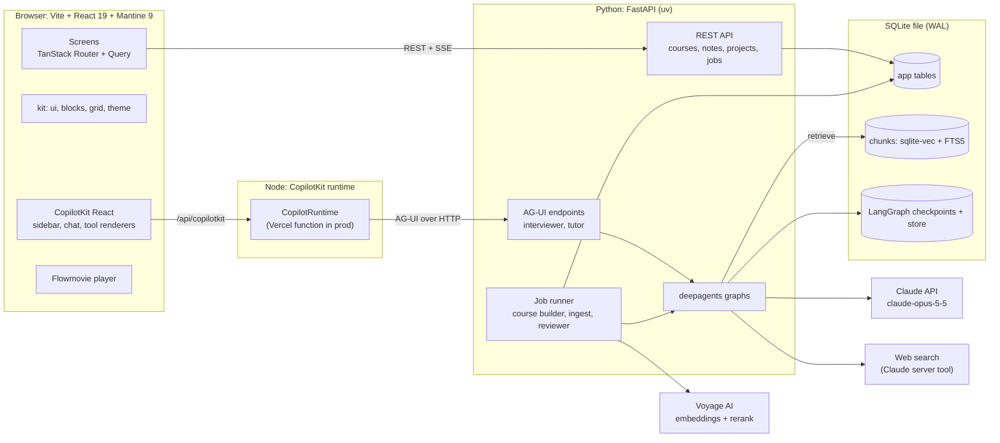
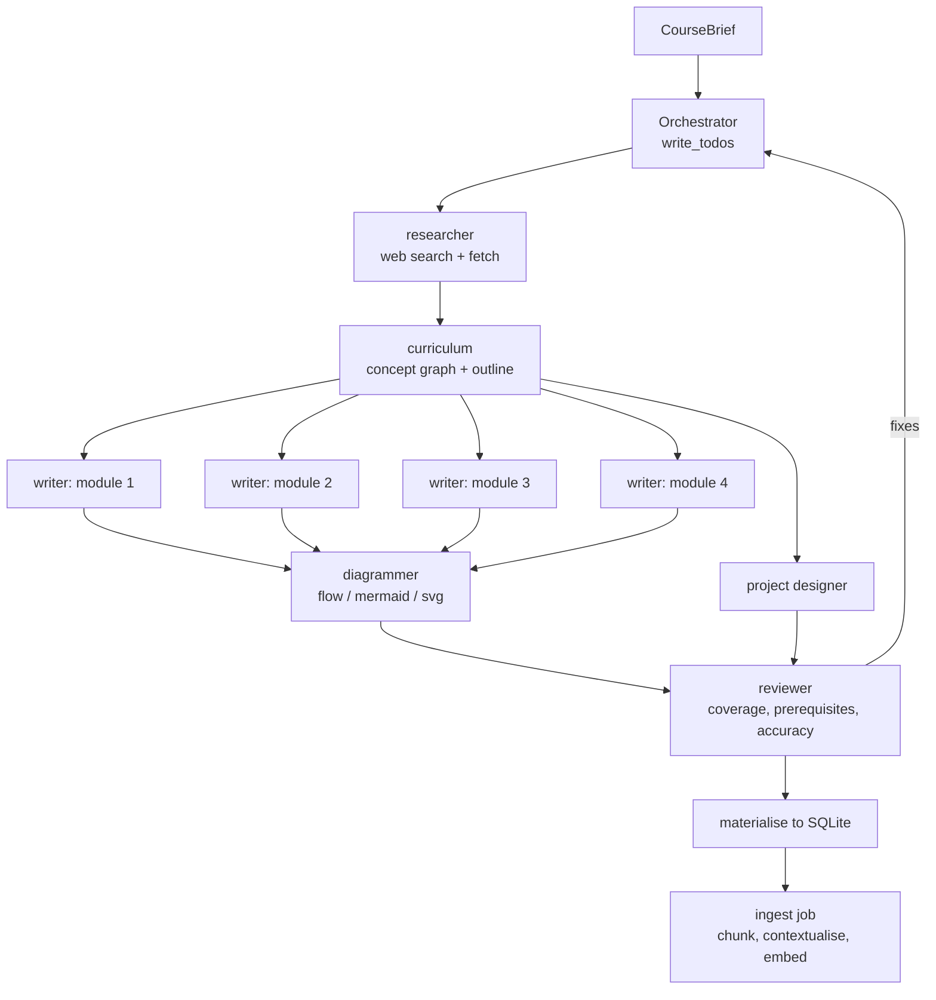
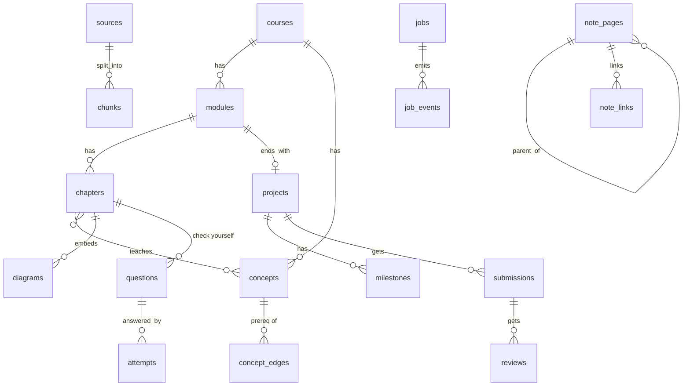

# Coursewright: end-to-end architecture plan

Status: implemented (first pass), 2026-11-05. See §11 for what was built and what differs. Design canvas: https://claude.ai/artifact/RRww3EWuxmjAgsok41XiNM

Coursewright is a personal course learner. You describe a topic, answer a short interview, and a team of
agents builds a course: modules, chapters, diagrams and projects. You read chapters, take Notion-style
notes, build the projects, and ask a tutor that answers from your course with citations.

---

## 1. System overview



Three processes in development, two deployables in production. The database is a single SQLite file the
Python service owns; nothing else opens it.

| Process | Tech | Dev | Prod |
| --- | --- | --- | --- |
| `web` | the scaffolded Vite app (this repo root) | `npm run dev` :5173 | Vercel static |
| `runtime` | `@copilotkit/runtime` handler | small Node server :4000, proxied by Vite | Vercel function at `/api/copilotkit` (repo already has `vercel.json`) |
| `agent` | FastAPI + deepagents + LangGraph | `uv run uvicorn` :8123 | Fly.io or Railway container |
| `db` | SQLite + `sqlite-vec` + FTS5, one file | `agent/data/coursewright.db` | the same file on a persistent volume, backed up by Litestream |

Why a Node runtime at all: CopilotKit's documented Deep Agents setup puts `CopilotRuntime` in a Node route
that forwards to the Python agent over AG-UI (`HttpAgent` pointing at the FastAPI endpoint). Its handler is
fetch-style (`createCopilotRuntimeHandler`), so it fits a Vercel function next to the Vite build. Verifying
this outside Next.js is spike S1.

---

## 2. Repository layout

Keep the Rocketship web app at the root so its harness (`init.sh`, `make check`, feature list) keeps working.
Add the other parts beside it.

```
coursewright/
  src/                      React app (scaffolded)
    routes/                 one route per screen
    features/
      library/  interview/  generating/  course/  chapter/
      project/  tutor/  notes/  sources/
    copilot/                CopilotKit provider, tool renderers, frontend tools
    illustrations/          the six animated stage scenes (SVG + CSS)
    flow/                   Flowmovie player wrapper
    api/                    typed REST client (existing Axios layer)
    mocks/                  MSW handlers per feature (keep: app boots with no backend)
  api/copilotkit/[[...slug]].ts   Vercel function: CopilotRuntime
  runtime-dev/server.ts     same handler under Node for local dev
  agent/                    Python, uv project
    app/main.py             FastAPI app, routers, AG-UI mounts
    app/agents/             interviewer, builder, tutor, reviewer, subagent specs
    app/tools/              retrieval, course read/write, flowmovie, web
    app/rag/                chunking, contextualisation, embeddings, search
    app/jobs/               job runner, events, workers
    app/db/                 SQLAlchemy models, Alembic migrations
    app/prompts/            system prompts as files, versioned
    vendor/flowmovie/       engine + check script (Node, called as subprocess)
    tests/  evals/
  agent/data/               SQLite database + per-job working folders (git-ignored)
  docs/plan/                this plan
```

---

## 3. Frontend

### 3.1 Stack (already scaffolded)

React 19, TypeScript strict, Vite 8, Mantine 9, TanStack Router + Query, Zustand, React Hook Form + Zod,
Axios, MSW, Storybook, Vitest, Playwright. Remove the template's sample pages (Dashboard, Customers,
Billing, Team, Inbox) in phase 1.

### 3.2 kit

| Package | Used for |
| --- | --- |
| `@shivarajbakale/theme` | Instrument theme (lime on near-black, Geist, 14/20 px radii). Replaces the copied `theme.ts`. |
| `@shivarajbakale/ui` | `AppShell` and `Sidebar` for every screen; `PageTree`, `PageHeader` (cover, icon, title), `IconPicker`, `CommandPalette` (⌘K), `NestedMenu`, `OptionChip`, `HoverPreview`, `DatePicker` in Notes. |
| `@shivarajbakale/blocks` | The notes editor, and the chapter renderer in read-only mode. Markdown in and out. |
| `@shivarajbakale/grid` | Notes database views (table, board, gallery), the Sources table, inline databases inside notes. |

kit is not on npm yet (`npm view` 404s). Phase 1 links it locally with `file:../kit/packages/<name>`
dependencies and runs `pnpm dev` in kit while working. Publish it before deploying. Versions match:
kit needs React ≥ 19 and Mantine ≥ 9, and the scaffold has React 19.2 and Mantine 9.6.

### 3.3 Our extensions to `blocks`

All built on the blocks extension API, so notes and chapters share them:

| Block or inline | What it does |
| --- | --- |
| `chapterMention` (inline, `@`) | Links to a chapter, a section anchor or a project. Hover card through `HoverPreview`. |
| `quote-from-source` | A quote that keeps a link to the chapter passage it came from. Made by "Add to notes" on a selection. |
| `quizCard` | A question the tutor asks you later. Feeds weak spots. |
| `flow` | Embeds a Flowmovie movie by id: play, scrub, step captions. |
| `mermaid` and `conceptGraph` | Static diagrams and graphs rendered on the client. |
| `tutorAnswer` | A saved tutor reply with its citations. |
| `askTutor` (slash command) | Sends the page, or the current block, to the tutor with an instruction. |

### 3.4 Routes

| Route | Screen | Data |
| --- | --- | --- |
| `/` | Library | `GET /courses`, `GET /notes/recent` |
| `/new` | Interview | AG-UI thread with the interviewer agent |
| `/courses/:id/building` | Generating | `GET /jobs/:id` + SSE `/jobs/:id/events` |
| `/courses/:id` | Course overview | `GET /courses/:id` (modules, chapters, progress, projects, weak spots) |
| `/courses/:id/chapters/:chapterId` | Chapter reader | `GET /chapters/:id`; side panel with notes or tutor |
| `/courses/:id/projects/:projectId` | Project | milestones, hints, reviews |
| `/tutor/:threadId?` | Tutor | AG-UI thread with the tutor agent |
| `/notes/:pageId?` | Notes | page tree + page doc |
| `/sources` | Sources | sources, chunk counts, index settings, test search |

### 3.5 CopilotKit

- One `<CopilotKit runtimeUrl="/api/copilotkit">` at the root. Two agents are registered in the runtime:
  `interviewer` and `tutor`.
- **Readable context** (sent with every tutor turn): current route, course id, chapter id, the visible
  section anchor, the text you selected, and the open note id. This is how the tutor knows "this chapter".
- **Frontend tools** the agent can call (they run in the browser, through the CopilotKit middleware on the
  Python side): `save_to_notes(markdown, pageId?)`, `open_chapter(chapterId, anchor?)`,
  `highlight_passage(chunkId)`, `start_quiz(conceptIds)`.
- **Tool renderers** turn backend tool calls into UI inside the chat: citations list, retrieved-passages
  panel, flow movie player, quiz card, the agent's step list (collapsed by default, as designed).
- **Interview questions** are a human-in-the-loop interrupt (see 4.2). The frontend renders each interrupt
  as the question card from the design, and resumes the graph with the answer.
- Where it appears: the right panel in the chapter reader, the full Tutor page, the "Ask about this page"
  button in Notes, the selection toolbar's "Ask tutor".

The exact v2 hook names for interrupts, shared state and tool rendering are checked in spike S1. CopilotKit
moved to a `/v2` package surface and the docs page for Deep Agents only shows `useDefaultRenderTool`.

### 3.6 Generating screen and illustrations

- Six hand-built animated SVG scenes, one per stage, ported from the design (`src/illustrations/`). They are
  React components, not generated images. That keeps them sharp, small and on-brand, and they work offline.
- Each scene takes live props from job events, so it feels specific to your course: topic words in the
  research scene, real concept names in the map, real module names on the slabs, chapter titles flying off
  the book, project names on the checklist, the chunk count in the index scene.
- Animations are CSS keyframes; `prefers-reduced-motion` turns them off.
- The page subscribes to `GET /jobs/:id/events` (SSE). It keeps working if you leave and come back, because
  events are stored (see 5.4).

### 3.7 Flowmovie

- The browser player is `vendor/flowmovie.js` + `flowmovie.css` from the flowmovie skill. Wrap it in
  `<FlowPlayer source=… />` and lazy-load it, since it is about 165 KB.
- The agent writes `.flow` text. The backend checks it before saving (see 4.5), so the browser only ever
  plays movies that compile.
- Licence: confirm we can ship the vendored player before phase 6.

---

## 4. Agents

### 4.1 Models

Defaults follow the current Claude lineup:

| Role | Model | Effort |
| --- | --- | --- |
| Course builder orchestrator | `claude-opus-5-5` | `high` |
| Writer, project, diagram and research subagents | `claude-opus-5-5` | `medium` |
| Tutor | `claude-opus-5-5` | `medium` (raise per route if evals show headroom) |
| Interviewer | `claude-opus-5-5` | `low` |
| Project reviewer | `claude-opus-5-5` | `high` |
| Chunk contextualisation (RAG) | `claude-opus-5-5` | `low` |

Notes:
- On Opus 5.5 thinking cannot be disabled and effort defaults to `medium`, so set effort explicitly on
  every agent.
- Forced `tool_choice` (`any` / `tool`) returns a 400 on Opus 5.5. Use `auto` with `strict: true` tools,
  or structured output, wherever we need a guaranteed shape (outline, concept graph, quiz).
- Turn on the server-side refusal `fallbacks` (`"default"`) if `langchain-anthropic` passes it through;
  check in spike S2.
- Cheaper models for the high-volume workers (Sonnet 5.5 or Haiku 5.5 for contextualisation and chapter
  drafts) are a cost decision for you to make once we can measure quality. One model also keeps one prompt
  cache.
- Long, stable system prompts and tool lists go first so prompt caching works; volatile context (selection,
  retrieved chunks) goes last.

Agents use `langchain-anthropic`'s `ChatAnthropic` because deepagents is built on LangChain and LangGraph.
Any direct call outside an agent (for example a one-off structured extraction) uses the official
`anthropic` Python SDK.

### 4.2 Interviewer (AG-UI, interactive)

A small LangGraph graph rather than a full deep agent: it should ask, not wander.

1. Reads your topic and drafts 3–6 questions with options and descriptions, one marked recommended, plus
   whether each allows several answers (structured output, the same shape as Claude Code's
   AskUserQuestion: header, question, options with label and description, multiSelect).
2. Asks them one at a time through a LangGraph `interrupt`. The frontend shows the question card, you
   answer or skip, and the graph resumes.
3. May ask one follow-up if an answer opens a real fork (for example "Contribute to open source" leads to
   "which projects?").
4. Writes a `CourseBrief` (topic, level, goal, pace, project kinds, explanation style, constraints) and
   shows the summary. "Generate course" creates the build job with that brief.

No uploads here, by design.

### 4.3 Course builder (background job, deep agent)

`create_deep_agent(...)` with its planning tool (todos), a virtual filesystem, and subagents through the
`task` tool. It runs as a background job, not inside a chat request, because it takes minutes.



| Subagent | Job | Output (files in the agent's filesystem) |
| --- | --- | --- |
| `researcher` | Finds what learners at this level struggle with, canonical references, common errors. Uses Claude's web search and web fetch server tools. | `/research/notes.md`, `/research/refs.json` |
| `curriculum` | Concept graph (concepts, prerequisite edges), then modules and chapter order sized to your pace. | `/course/graph.json`, `/course/outline.json` |
| `writer` (one per module, in parallel) | Chapters in our block markdown: key idea callout, explanation, worked example, a diagram request, 2–4 check-yourself questions with explanations. | `/course/chapters/<id>.md` |
| `diagrammer` | Picks the diagram kind per request: Flowmovie for processes and protocols, Mermaid or SVG for structure, graph for relationships. Writes it and runs the check tool until it passes. | `/course/diagrams/<id>.flow` or `.mmd` |
| `project_designer` | One project per module: brief, starter layout, milestones each with a check command, hints in order, rubric. | `/course/projects/<id>.json` |
| `reviewer` | Checks coverage against the outline, that nothing comes before its prerequisites, and that questions match the chapters. Sends fixes back as todos. | `/course/review.md` |

Storage: a `CompositeBackend`, with the default `StateBackend` for scratch files and a `FilesystemBackend`
rooted at `agent/data/jobs/<job_id>/` for `/course/`. Files on disk plus the SQLite checkpointer let a crashed
run resume, and we avoid needing a LangGraph store (no SQLite store is documented, see spike S5). When the
reviewer passes, `materialise` parses the files (Pydantic, strict) and writes the course tables in one
transaction.

Progress: every todo change, subagent start and end, and file write becomes a `job_event` (stage, message,
payload). The Generating screen maps them onto its six stages: research, concept map, outline, chapters,
projects, index.

### 4.4 Tutor (AG-UI, interactive, deep agent)

| Tool | Does |
| --- | --- |
| `search_course(query, scope)` | Hybrid retrieval over chunks (5.2). Scope: chapter, course, all courses. Returns chunks with ids, scores and anchors. |
| `read_chapter(id, section?)` | Full text when the answer needs more than chunks. |
| `read_notes(query \| pageId)` | Your notes, which are indexed too. |
| `get_progress(courseId)` | Finished chapters, quiz results, weak spots. Lets it pitch the answer. |
| `make_flow(spec)` | Calls the diagrammer subagent and returns a checked `.flow` for the chat to play. |
| `make_quiz(conceptIds, n)` | Questions grounded in chapters. |
| web search (server tool) | Off by default; on when the scope is "the web" or the course has nothing on it. |
| Frontend tools | `save_to_notes`, `open_chapter`, `highlight_passage`, `start_quiz` (3.5). |

Answer contract in the system prompt: cite course chunks as `[n]`, say when the course doesn't cover
something, prefer your own course's wording and examples, keep it short unless asked, offer a movie when
the answer is a process. Conversation state lives in the LangGraph SQLite checkpointer (`AsyncSqliteSaver`), one thread per
conversation.

### 4.5 Project reviewer (background job)

You submit a public repo URL and a milestone. The job fetches the repo tree and the relevant files through
the GitHub API (no cloning, no running code in v1), reads the milestone's rubric and the linked chapters,
and returns findings tagged Pass, Fix or Idea, each linked to a chapter section. Running the check commands
in a sandbox is a later option.

### 4.6 Flowmovie inside the agent service

- `agent/vendor/flowmovie/` holds the engine and `check.mjs`. The image includes Node 20.
- Tool `flow_check(source)` runs `node check.mjs` as a subprocess with a timeout and returns errors and
  warnings. `flow_story(source)` returns the scene-by-scene text so the diagrammer can confirm the movie
  tells the right story.
- Only movies that pass are saved. The diagrammer gets three attempts, then falls back to Mermaid.

---

## 5. RAG

### 5.1 What gets indexed

Generated chapters (always), your notes (on save, debounced), saved tutor answers, and uploads from the
Sources page (PDF, Markdown, URLs; still to be decided, see 10). Course creation never takes uploads.

### 5.2 Pipeline

1. **Parse** to block markdown (`pypdf` for PDFs, readability-style extraction for URLs).
2. **Chunk** by structure first (headings, blocks), then by size: about 800 tokens with 120 overlap. Never
   split code blocks or equations. Each chunk keeps `course_id`, `chapter_id`, section anchor, block ids and
   source type, so citations can jump to the exact passage.
3. **Contextualise**: prepend one or two sentences saying where the chunk sits ("From 3.2 Leader election,
   section Randomised timeouts, in a Distributed Systems course"). Cache the document in the prompt so it is
   cheap.
4. **Embed** with Voyage AI (Anthropic's recommended embeddings partner). Pick the model in spike S3; a
   contextual-chunk model is a good fit for chapters. Store the dimension in config.
5. **Store** the text and metadata in `chunks`, the embedding in a `sqlite-vec` `vec0` virtual table
   (`chunk_vectors`, same rowid), and the text again in an FTS5 table (`chunks_fts`) for keyword search.
   `sqlite-vec` searches by brute force, with no ANN index. That is fast enough for one person's library
   (tens of thousands of chunks); filter by `course_id` first to keep each search small.

Search: run vector top-k and full-text top-k, merge with reciprocal rank fusion, filter by scope, rerank
with Voyage rerank, and keep 3–8. The Sources page "Test retrieval" box calls the same function.

### 5.3 Re-indexing

Chunks carry `content_hash` and `embed_model`. Re-index jobs skip unchanged chunks; changing the model
re-embeds everything (one button on the Sources page).

### 5.4 Jobs

One `jobs` table plus `job_events`, and a small async worker inside the agent service. It claims work with
`BEGIN IMMEDIATE` and `UPDATE jobs SET status='running' … RETURNING`. That is enough for one user, needs no
Redis, and keeps all state in one file.

SQLite settings: WAL mode, `busy_timeout` 5 s, `foreign_keys` on, one write connection shared through an
async lock, many readers. Long agent runs never hold a write transaction open: they write events and
checkpoints in short transactions. Job kinds: `build_course`, `ingest`, `review_project`, `reindex`. SSE streams `job_events` by id,
so a refreshed page replays from the last event id it saw.

---

## 6. Data model



| Table | Key columns |
| --- | --- |
| `courses` | id, title, slug, brief (JSON: the interview answers), status (`planning`, `building`, `ready`, `failed`), colour, created_at |
| `modules` | id, course_id, position, title, summary |
| `chapters` | id, module_id, position, title, doc (JSON blocks), markdown, reading_minutes, status |
| `concepts`, `concept_edges` | id, course_id, name, summary; from_id, to_id, kind (`prereq`) |
| `chapter_concepts` | chapter_id, concept_id |
| `diagrams` | id, chapter_id, kind (`flow`, `mermaid`, `svg`, `graph`), source, checked_at |
| `questions`, `attempts` | id, chapter_id, concept_ids, prompt, options, answer, explanation; question_id, chosen, correct, at |
| `projects`, `milestones` | id, module_id, brief, starter (JSON), hints (JSON), rubric; id, project_id, position, title, body, check_cmd, done_at |
| `submissions`, `reviews` | id, project_id, milestone_id, repo_url, focus; id, submission_id, findings (JSON) |
| `progress` | chapter_id, started_at, finished_at, scroll_anchor |
| `note_pages` | id, parent_id, position, title, icon, cover, properties (JSON), doc (JSON blocks), course_id, chapter_id, updated_at, trashed_at |
| `note_links` | from_page_id, to_kind, to_id (backlinks and mentions) |
| `sources`, `chunks` | id, kind, title, uri, status, error; id, source_id, course_id, chapter_id, anchor, text, context, content_hash, embed_model; plus `chunk_vectors` (vec0) and `chunks_fts` (FTS5) keyed by chunk rowid |
| `jobs`, `job_events` | id, kind, status, input, output, error, attempts; id, job_id, seq, stage, message, payload, at |

JSON columns are `TEXT` holding JSON, queried with SQLite's JSON functions when needed; ids are UUID text.
LangGraph keeps its checkpoint tables in the same file (`langgraph-checkpoint-sqlite`). Migrations: Alembic
in batch mode, since SQLite can't alter most columns in place. The vec0 and FTS5 tables are created in raw
SQL migrations.
Weak spots are derived (a concept with two or more wrong attempts recently), not stored.

---

## 7. APIs

REST (FastAPI, JSON, Pydantic models exported to TypeScript with `openapi-typescript` so the client stays
typed):

```
GET    /courses                     POST /courses (from brief → creates build job)
GET    /courses/:id                 DELETE /courses/:id
GET    /chapters/:id                POST /chapters/:id/progress
POST   /questions/:id/attempts
GET    /projects/:id                PATCH /milestones/:id
POST   /projects/:id/submissions    GET /submissions/:id
GET    /notes/tree                  GET/PUT/PATCH/DELETE /notes/:id
GET    /notes/search?q=             GET /notes/recent
GET    /sources                     POST /sources (upload or url)   POST /sources/reindex
POST   /search/test                 (Sources "Test retrieval")
GET    /jobs/:id                    GET /jobs/:id/events (SSE)
GET    /diagrams/:id
```

AG-UI (mounted with `add_langgraph_fastapi_endpoint`, reached only through the CopilotKit runtime):
`/agents/interviewer`, `/agents/tutor`.

MSW handlers mirror every REST route, so the frontend keeps booting with no backend, as the template
intends.

---

## 8. Cross-cutting

- **Auth:** single user. Locally none; in production one shared secret checked by both the runtime function
  and FastAPI, sent as a header. A proper sign-in can come later without schema changes (add `user_id`
  columns then).
- **Secrets:** `ANTHROPIC_API_KEY`, `VOYAGE_API_KEY`, `DATABASE_URL`, `GITHUB_TOKEN` (reviewer, optional),
  `LANGSMITH_API_KEY` (optional). Never in the web bundle.
- **Observability:** LangSmith tracing for agent runs (deepagents and LangGraph support it natively);
  structured logs; token usage per job written to `jobs.output.usage` so the Library can show what a course
  cost to build.
- **Cost guards:** a token budget per build job and per tutor turn; cancel button on the Generating screen.
- **Evals:** a small set per agent from day one.
  - Tutor: 30 questions on a seeded course, graded for groundedness (claims supported by cited chunks),
    citation accuracy and "says when it doesn't know".
  - Builder: a rubric grade of outline coverage, prerequisite order, question quality and diagram validity.
  - Interviewer: questions are relevant, options are distinct, at most 6.
- **Testing:** Vitest + Storybook for components (kit already has a11y and visual tests), Playwright for
  the main journeys against MSW, pytest for API, tools and RAG, a nightly live-model smoke test.

---

## 9. Build order

| Phase | Delivers | Done when |
| --- | --- | --- |
| **0. Spikes** (1–2 days) | S1 CopilotKit v2 runtime as a Vercel function and a local Node server, talking to a deepagents graph over AG-UI, with one interrupt rendered as a question card. S2 deepagents + `ChatAnthropic("claude-opus-5-5")` with effort, structured output and fallbacks. S3 Voyage model choice on 20 sample questions. S4 kit linked into the app; Flowmovie player embedded and licence confirmed. S5 `sqlite-vec` loads in the uv-managed Python (macOS's system Python can block extension loading), `AsyncSqliteSaver` works under the AG-UI endpoint, and deepagents' `FilesystemBackend` resumes after a restart. | Each spike has a tiny working example and a note in `docs/plan/spikes.md`. |
| **1. Foundation** | Remove template pages; kit theme and `AppShell`; all nine routes with MSW data from the designs; SQLite file with `sqlite-vec` loaded; FastAPI skeleton; Alembic schema; typed client generation; `make check` covering both halves. | Every screen renders from mocks; the API serves health and courses from SQLite. |
| **2. Notes** | kit `PageTree` + `PageHeader` + `blocks` editor; autosave; Table/Board/Cards views with `grid`; mentions and backlinks; ⌘K search. | You can use Notes daily without AI. |
| **3. Reading** | Course overview and Chapter reader from real tables, using a hand-seeded course; progress; check-yourself questions; selection toolbar ("Add to notes" works). | A seeded course is fully readable and quiz-able. |
| **4. Building courses** | Interviewer over AG-UI; job runner; course builder with all subagents; materialise; Generating screen with live illustrations. | "Learn Rust ownership" goes from interview to a readable course with no manual steps. |
| **5. Tutor + RAG** | Ingest pipeline; hybrid search; tutor agent; CopilotKit in the chapter panel, the Tutor page and Notes; citations; save to notes. | Tutor evals pass the bar we set in phase 0. |
| **6. Diagrams** | Flowmovie (agent check tool, `flow` block, player), Mermaid, concept graph on the course page; "Show it as a movie" in the tutor. | Every process-type chapter in a new course has a movie that plays. |
| **7. Projects** | Milestones, hints, submissions, reviewer job, weak spots driving tutor drills. | A submitted repo gets a review linked to chapters. |
| **8. Ship** | Sources page (if kept); deploy (Vercel + Fly or Railway with a volume for the SQLite file, Litestream backups); auth secret; cost display; publish kit packages. | Works from your phone at a real URL. |

Phases 2 and 3 don't depend on the agents, so they can run while phase 0's findings settle.

---

## 10. Open decisions

1. **Sources page uploads.** Course creation takes no uploads. Keep a separate Sources page for extra
   reading the tutor can use, or drop uploads entirely?
2. **Cheaper worker models.** Everything defaults to `claude-opus-5-5`. Moving contextualisation or chapter
   drafts to Sonnet 5.5 or Haiku 5.5 is your call once evals can measure the difference.
3. **Hosting.** Fly.io or Railway for the Python service, with a persistent volume for the SQLite file.
   Litestream backups to S3 or Cloudflare R2. A serverless Python host won't work, since the file needs a
   disk that stays put.
4. **Project checks.** Review by reading code only (v1), or later run check commands in a sandbox.
5. **kit distribution.** Publish the four packages to npm, or keep them linked from `~/Projects/kit`.

---

## 11. Implementation status (2026-11-05)

Built end to end: all nine screens (web), the CopilotKit runtime (`runtime-dev/`, Vercel function in
`api/copilotkit/`), and the agent service (`agent/`): REST, SQLite + sqlite-vec + FTS5 hybrid search,
job worker with SSE, interviewer, course builder (deepagents with researcher, curriculum, writer,
project designer and reviewer subagents), materialise, ingest, project reviewer, and the tutor over AG-UI
with `AsyncSqliteSaver`. A seeded Raft course makes everything except Claude calls work without keys.

Differences from the plan above:
- The interview is REST (`POST /api/interview/next`), not an AG-UI interrupt, so course creation does not
  depend on CopilotKit.
- Notes and chapters store markdown (kit `blocks` reads and writes it), not a JSON block tree.
- Plain SQL migrations applied at startup (`agent/app/db/migrations/`), not Alembic.
- Phase 1 kept the template's Mantine shell; kit supplies the notes UI (PageTree, PageHeader, IconPicker,
  blocks editor) and renders chapters, project briefs and markdown read-only.

Not built yet: the diagrammer subagent and Flowmovie check tool in the builder (writers produce Mermaid;
the seeded course has a checked Flowmovie), builder checkpointing (a crashed build restarts), tutor tools
`make_flow`, `make_quiz`, web search, frontend tools `highlight_passage` and `start_quiz`, custom blocks
extensions (`chapterMention`, `quizCard`, `flow`), evals, auth secret, deployment. Nothing has been run
against the live Claude API yet in this environment (no key), so prompts and effort settings are untested.

## References

- CopilotKit, Deep Agents with FastAPI: https://docs.copilotkit.ai/langgraph-fastapi/deep-agents
- CopilotKit blog, frontend for Deep Agents: https://www.copilotkit.ai/blog/how-to-build-a-frontend-for-langchain-deep-agents-with-copilotkit
- LangChain, deepagents backends: https://docs.langchain.com/oss/javascript/deepagents/backends
- kit: `~/Projects/kit/README.md`, `packages/ui/README.md`
- Flowmovie skill: `~/.claude/skills/flowmovie/SKILL.md`
